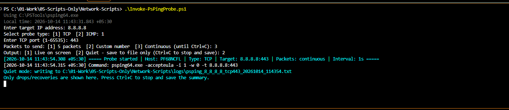
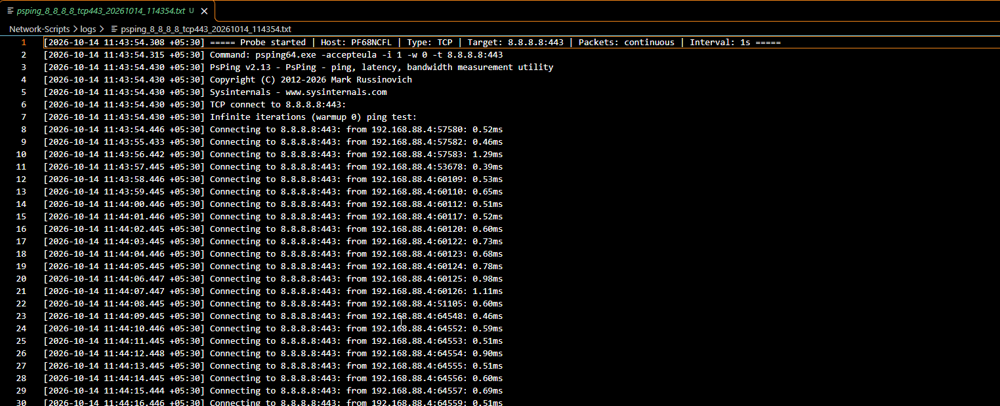

# Invoke-PsPingProbe.ps1

Interactive PowerShell wrapper around Sysinternals **PsPing**. It probes one IP over **TCP** or **ICMP**
and records every result with a local timestamp, so you can find network drops and when they happened.

## Requirements

- Windows PowerShell 5.1 or PowerShell 7+
- **Sysinternals PsPing** (`psping.exe` or `psping64.exe`). **The script cannot run without it.**

### PsPing check and automatic install

On every start the script checks whether PsPing is available, looking in this order:

1. The path given with `-PsPingPath`
2. The script's own folder
3. Your `PATH`

If PsPing is not found, the script warns you that it is required and asks:
**"Download PsPing now and add it to your user PATH? (Y/N)"**

- **Yes**:
  1. Downloads `psping64.exe` (or `psping.exe` on 32-bit Windows) from `https://live.sysinternals.com`.
  2. Verifies the file has a valid **Microsoft digital signature**. If not, it is discarded.
  3. Installs it to `%LOCALAPPDATA%\PsPing`.
  4. Adds that folder to your **user** `PATH` (no admin rights needed) and to the current session.
  5. Carries on with the probe, with no restart needed.
- **No**: the script exits, since it cannot work without PsPing.

Notes:
- The new `PATH` entry appears in terminals opened after the install. The current run already uses it.
- The download needs internet access to `live.sysinternals.com`. If that is blocked by a proxy or firewall, download PsPing
  manually from <https://learn.microsoft.com/sysinternals/downloads/psping> and place it next to the script.
- `-accepteula` is passed automatically.

## Usage

```powershell
.\Invoke-PsPingProbe.ps1
.\Invoke-PsPingProbe.ps1 -Interval 2
.\Invoke-PsPingProbe.ps1 -PsPingPath C:\PSTools\psping64.exe -LogDirectory D:\netlogs
```

| Parameter       | Default            | Purpose                                  |
|-----------------|--------------------|------------------------------------------|
| `-Interval`     | `1`                | Seconds between probes (1–3600)          |
| `-PsPingPath`   | auto-detect        | Full path to `psping.exe`/`psping64.exe` |
| `-LogDirectory` | `.\logs` (by script) | Where the `.txt` output files are written            |

## Prompts

1. **Target IP**: IPv4 or IPv6, validated.
2. **Probe type**: `1` TCP or `2` ICMP.
3. **TCP port** (TCP only): 1–65535.
   If the port is blank or invalid, you are asked **"Restart the script? (Y/N)"**.
   Yes starts again from the IP prompt. No exits without probing.
4. **Packets to send**: `1` 5 packets, `2` custom number, `3` continuous (runs until Ctrl+C).
5. **Output**: `1` live on screen, or `2` quiet (file only).
6. After a finite run: **"Run another probe? (Y/N)"**.

### Quiet mode and Ctrl+C

Quiet mode writes everything to the log file. The console shows only `[DROP]`, `[RECOVERED]` and
`[OUTAGE ONGOING AT END]` events, so you can leave it running in a window for hours.
Press **Ctrl+C** at any time (live or quiet): PsPing is stopped, the summary is written and the log file is saved.

> Quiet mode keeps running in the console window you started it in; it is not a detached service.
> To keep it running after you log off, run it inside a persistent session (for example a scheduled task).

## Example run

The screenshots below show a continuous TCP probe to `8.8.8.8:443` in quiet mode, stopped with Ctrl+C.

### Step 1: Answer the prompts

Start the script and answer the prompts: target IP, probe type (`1` TCP), port (`443`), packets (`3` continuous) and output
(`2` quiet). The console confirms the log file path and tells you to press **Ctrl+C** to stop. In quiet mode nothing more is
printed unless a drop occurs.



### Step 2: The log file fills in while it runs

Open the `.txt` file from the `logs` folder at any time, even while the script is running. It starts with the header (host,
probe type, target, packets, interval) and the exact PsPing command. Each probe then gets its own local timestamp and latency.



### Step 3: Press Ctrl+C and read the summary

When you press Ctrl+C, PsPing stops and the log is closed with PsPing's own statistics and the script's **SUMMARY** block:
start and end time, duration, probes sent, successes, drops, loss % and any outages. Here: 42 probes, 0 dropped, no outages.


If a drop had occurred, you would see `[DROP]` lines with timestamps in the log, and the outage start and end times in the summary.

## What gets logged

Every line is prefixed with the **local time of the machine running the script**, including milliseconds and UTC offset:

```
[2026-10-14 11:42:24.504 +05:30] [DROP] The remote computer refused the network connection.
[2026-10-14 11:42:31.210 +05:30] [RECOVERED] Connectivity restored. Outage began 2026-10-14 11:42:24, 7 probe(s) lost, ~7.0s.
```

- `[DROP]` marks a failed probe (timeout, unreachable, refused, TTL expired, resolve/connect failure, etc.).
- Consecutive drops are grouped into an **outage** with start time, end time, probes lost and duration.
- A **SUMMARY** block at the end gives total probes, successes, drops, loss % and the outage list.
- The header records computer name, probe type, target, packet count and interval, plus the exact PsPing command.

Output is saved as plain text (`.txt`), one file per run:

`logs\psping_<ip>_<tcpPORT|icmp>_<yyyyMMdd_HHmmss>.txt`

Example: `logs\psping_10_0_0_5_tcp443_20261014_114222.txt`

## How it behaves

- Warm-up is disabled (`-w 0`) so every attempt counts, including the first.
- A **closed TCP port counts as a drop** (connection refused). Use a port you know is listening.
- Outage duration is measured by this machine's clock, from the first failed probe to the first success after it.
  It is accurate to about one interval plus PsPing's timeout (~5 s for ICMP).
- A drop against a long timeout can take several seconds to appear, since PsPing waits before reporting it.
- ICMP may be blocked by firewalls or deprioritised by routers. If ICMP shows drops but TCP does not, the path is probably filtering ICMP.

## Troubleshooting

| Symptom | Fix |
|---------|-----|
| Auto-download fails | Check internet/proxy access to `live.sysinternals.com`, or install PsPing manually and use `-PsPingPath` |
| Script blocked by execution policy | `powershell -ExecutionPolicy Bypass -File .\Invoke-PsPingProbe.ps1` |
| ICMP shows 100% loss but host is up | Target or a firewall is dropping ICMP; test TCP instead |
